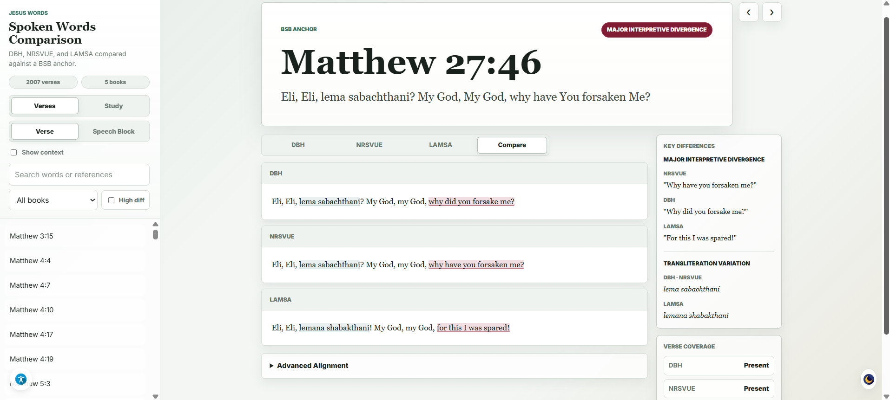
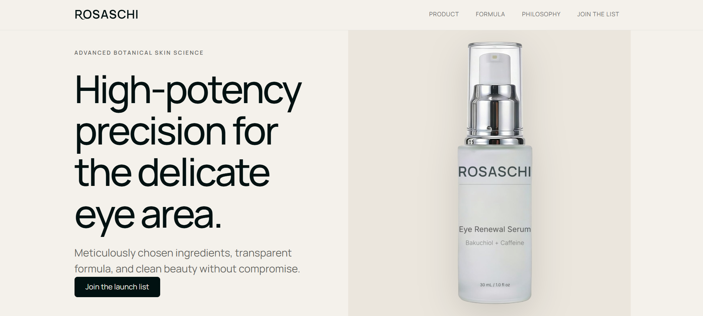

# Primo Vargas IV

**Technical Operations | Quality Assurance | AI-Assisted Development**

Technical professional with a background in utility-scale renewable energy construction, surveying, data verification, process optimization, and project leadership.

I combine hands-on experience managing complex technical operations with practical experience in software development, automation, and artificial intelligence.

My work focuses on translating requirements into functional solutions, identifying inefficiencies, developing improvements, and systematically evaluating results. I approach technical challenges with an emphasis on accuracy, efficiency, and continuous improvement.

---

## Featured Projects

### [Jesus Words Project](https://github.com/PrimoIV/jesus-words-project)

**Interactive Research & Text Exploration Application**

Developed an interactive web application for exploring, comparing, searching, and organizing structured textual information across multiple translations.

* Searchable, categorized content with interactive navigation.
* Side-by-side translation comparison and difference highlighting.
* Accessibility controls, including high contrast, adjustable text size, and reduced motion.
* User annotations and locally saved notes.
* Structured JSON datasets supported by automated data-processing, validation, and auditing scripts.
* Responsive interface with customizable display settings.

**Technologies:** JavaScript, HTML5, CSS3, JSON, Python, Node.js.

### [ROSASCHI Website](https://github.com/PrimoIV/rosaschi-site)

**Brand Website, Front-End Development & Custom Automation**

Developed a responsive website for a skincare brand, combining custom front-end design with functional integrations and independently programmed automation.

* Custom website layout, visual design, and responsive styling.
* Integrated contact forms using Formspree.
* Designed and implemented custom mailing list automation and subscriber management functionality.
* Developed privacy policy, terms of service, and supporting informational pages.
* Deployed and maintained the website using GitHub Pages.

**Technologies:** HTML5, CSS3, JavaScript, GitHub Pages.

### SEQARRA Biosciences

**Private E-Commerce Development Project | Active Development**

Independently developing a research-use-only product catalog and documentation platform using modern web technologies and AI-assisted software development workflows.

The project emphasizes maintainable architecture, structured product data, performance optimization, and reliable documentation systems.

* Responsive product catalog with dynamic product detail pages.
* Configuration-driven product data and variant management.
* Lot-specific documentation, traceability, and certificate verification.
* Interactive search, navigation, and cart functionality.
* Performance optimization through code splitting, image optimization, and reduced JavaScript overhead.
* Reduced homepage Largest Contentful Paint (LCP) from approximately 4.41 seconds to 2.39 seconds, a 46% improvement.
* Automated regression testing, TypeScript validation, and responsive interface testing.
* Version control, technical documentation, and iterative development workflows.

**Technologies:** Next.js, React, TypeScript, Tailwind CSS, Node.js, Git, GitHub.

**Status:** Active development. Private repository. Public technical showcase planned.

---

## Professional Background

My professional experience includes technical leadership roles in utility-scale renewable energy construction, including Survey Superintendent and Acting Site Superintendent.

I've worked on solar projects ranging from approximately 75 MW to 550 MW, where precision, coordination, operational efficiency, and systematic problem-solving were essential.

**Key areas of experience:**

* Technical surveying, measurement, and data verification.
* Interpreting engineering plans, specifications, and technical documentation.
* Managing field operations across large-scale construction projects.
* Developing operational procedures and implementing quality standards.
* Coordinating personnel, equipment, resources, and project requirements.
* Identifying workflow inefficiencies and implementing process improvements.
* Troubleshooting technical problems and maintaining operational accuracy.
* Optimizing labor utilization and reducing man-hours through improved workflows and execution strategies.

---

## Technical Experience & Tools

### Quality Assurance & Technical Practices

Data verification, technical research, software testing, troubleshooting, process optimization, documentation, workflow analysis, and quality control.

### Development & Programming

HTML5, CSS3, JavaScript, TypeScript, React, Next.js, Node.js, Python, JSON, Git, GitHub, and VS Code.

### Design & Technical Software

Affinity, Trimble Business Center, Trimble surveying equipment, and Topcon systems.

### AI-Assisted Development

Practical experience using AI-assisted development tools to translate requirements into implementations, develop and refine application functionality, troubleshoot issues, evaluate generated code, and verify results through testing.

My approach emphasizes understanding requirements, identifying problems, validating functionality, and improving solutions through structured iteration.

---

## Current Focus

I'm actively expanding my experience in:

* Large language model evaluation and response quality assessment.
* Data annotation, factual verification, and instruction adherence.
* AI-assisted software development, debugging, and technical problem-solving.
* Structured data processing, validation, and quality assurance.
* Research methodologies, systematic evaluation, and workflow optimization.

I'm particularly interested in opportunities that combine analytical thinking, technical problem-solving, quality assurance, and artificial intelligence.

My goal is to apply my technical operations background and practical development experience to projects involving AI evaluation, data quality, software functionality, and technology-driven process improvement.

---

**Interested in:** AI Evaluation | Technical Research | Data Quality | Quality Assurance | Technical Operations
